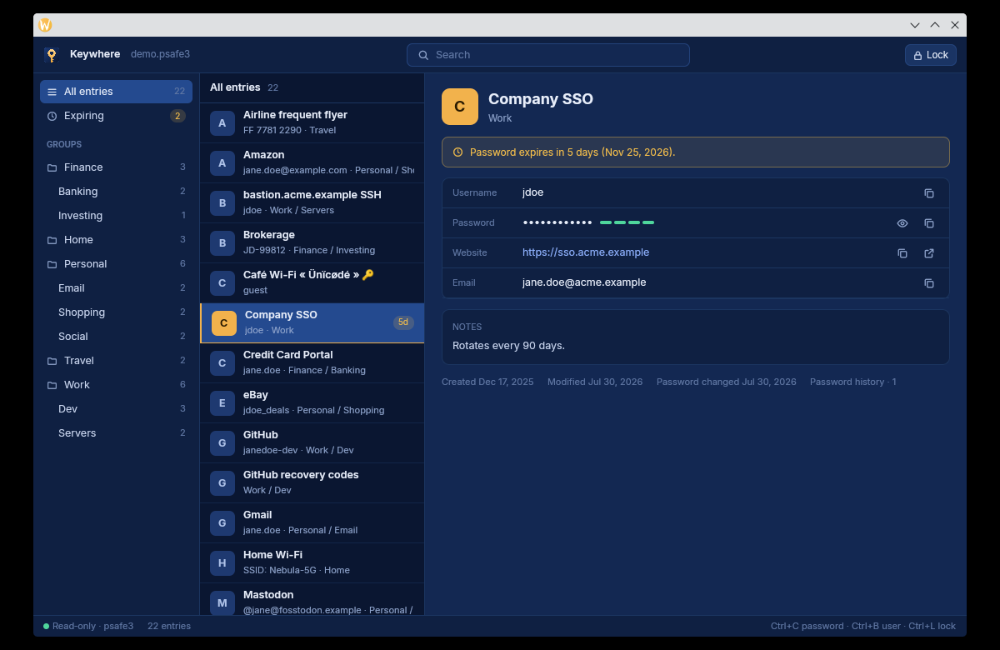

<p align="center"></p>
<h1 align="center">Keywhere</h1>
<p align="center">A modern, cross‑platform password manager for <b>Password Safe v3</b> (<code>.psafe3</code>) vaults.<br>
Works with files from Password Safe and Password Gorilla. No cloud account, no subscription, no nags.</p>

> **Status: early development (M1, read‑only viewer).** The vault engine is tested against
> Password Safe; the app can unlock, browse, search and copy. Editing comes in M2. Keep backups.

<p align="center"></p>

## Using it (M1)

```sh
cargo run --release -p keywhere -- path/to/vault.psafe3
```

| Shortcut (Ctrl → ⌘ on macOS) | Action |
|---|---|
| `Ctrl+F` / `Ctrl+K` | Search |
| `↑` `↓` | Move selection |
| `Enter` in search, double‑click | Copy password |
| `Ctrl+C` / `Ctrl+B` | Copy password / username (clipboard clears after 30 s) |
| `Ctrl+R` | Reveal password for 15 s |
| `Ctrl+U` | Open website |
| `Ctrl+L` | Lock (also automatic after 5 min idle) |

## Why

* **Password Gorilla** is discontinued and its Tcl/Tk UI shows its age.
* **Password Safe** is solid but cluttered.
* **Strongbox** looks great but is macOS‑only and keeps pushing Pro.

Keywhere keeps the format you already have and adds a calm, keyboard‑first UI built with
[GPUI](https://gpui.rs) (the GPU‑accelerated Rust UI framework behind Zed).

## Features (planned → see [docs/PLAN.md](docs/PLAN.md))

- Open/save `.psafe3` files, interoperable with Password Safe 1.x and Password Gorilla
- Three‑pane browser: smart views, group tree, instant search, detail card
- One‑click copy with clipboard auto‑clear (clipboard‑history exclusion planned for M3)
- Auto‑lock on idle, sleep and screen lock
- Tray icon with quick search, password generator, expiry and weak‑password views
- Linux, macOS, Windows

Mockups: [docs/mockups/keywhere-mockups.html](docs/mockups/keywhere-mockups.html)

## Security

Threat model: [docs/security-review-grok.md](docs/security-review-grok.md). The engine uses the
RustCrypto crates (`twofish`, `cbc`, `sha2`, `hmac`), constant‑time checks, authenticate‑before‑parse,
input size caps, zeroized secrets and an atomic, verified save with a `.ibak` backup.
Please report vulnerabilities privately via GitHub Security Advisories.

## Build

```sh
cargo test -p keywhere-core      # vault engine tests
cargo run --release -p keywhere  # desktop app (Linux needs wayland/x11, xkbcommon, vulkan dev libs)
```

## Fonts

The UI bundles [Inter](https://rsms.me/inter/) (SIL Open Font License 1.1, `assets/fonts/Inter-LICENSE.txt`).

## License

MIT, see [LICENSE](LICENSE). `third_party/xattr` is a patched copy of the MIT/Apache‑2.0 `xattr` crate.
