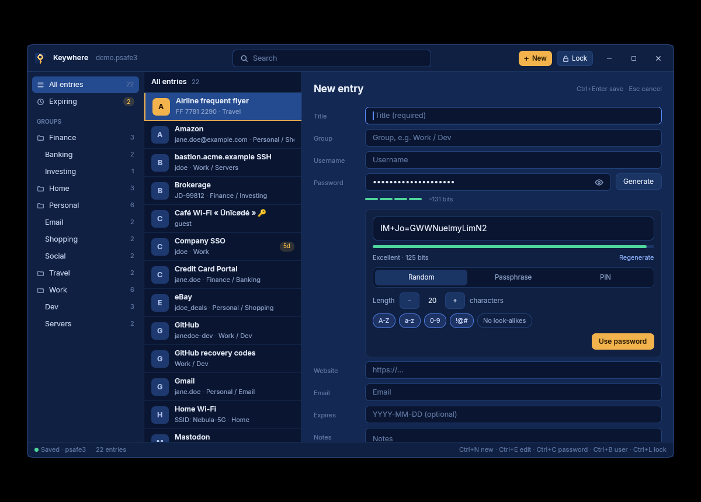

<p align="center"></p>
<h1 align="center">Keywhere</h1>
<p align="center">A modern, cross‑platform password manager for <b>Password Safe v3</b> (<code>.psafe3</code>) vaults.<br>
Works with files from Password Safe and Password Gorilla. No cloud account, no subscription, no nags.</p>

> **Status: early development (M3, tray & system integration).** The vault engine is tested against Password Safe;
> the app can unlock, browse, search, copy, add, edit, duplicate and delete entries, and generate
> passwords. Every save keeps the previous file as `.ibak`. Keep backups anyway.

<p align="center"></p>

<p align="center"></p>

## Using it

```sh
cargo run --release -p keywhere -- path/to/vault.psafe3
```

| Shortcut (Ctrl → ⌘ on macOS) | Action |
|---|---|
| `Ctrl+F` / `Ctrl+K` | Search |
| `↑` `↓` | Move selection |
| `Enter` in search, double‑click | Copy password |
| `Ctrl+C` / `Ctrl+B` | Copy password / username (clipboard clears after 30 s) |
| `Ctrl+R` | Reveal password for 15 s |
| `Ctrl+U` | Open website |
| `Ctrl+N` / `Ctrl+E` / `Ctrl+D` | New / edit / duplicate entry |
| `Delete` | Delete entry (asks first) |
| `Enter` / `Ctrl+Enter` in editor | Save (`Esc` cancels) |
| `Ctrl+L` | Lock (also automatic after 5 min idle) |

### Tray, global shortcut and auto‑lock (M3)

* **Tray icon** (Linux: KDE, GNOME with the AppIndicator extension, etc.): left‑click opens
  Keywhere; the menu has *Open*, *Lock* and *Quit*. It never shows entry titles.
* **Closing the window locks the vault** and keeps Keywhere minimised with the tray icon (tray → *Quit*
  exits). Without a tray, closing quits.
* **Global shortcut:** Keywhere is single‑instance. Bind any key to the command `keywhere --show`
  (KDE: *System Settings → Keyboard → Shortcuts → Add New → Command*; GNOME: *Settings → Keyboard →
  Custom Shortcuts*). It brings Keywhere to the front with search focused, or the unlock field if locked.
* **Auto‑lock** after 5 min idle, when the screen locks (logind / ScreenSaver) and before the system
  sleeps.
* **Clipboard:** copied secrets are marked *exclude from history* (KDE Klipper hint, Windows
  history/cloud exclusion, macOS concealed type) and cleared after 30 s, on lock and on quit.

macOS/Windows: clipboard protection works; tray and lock‑on‑sleep hooks are not implemented yet.

Saving is safe for synced folders: Keywhere refuses to overwrite a vault that changed on disk
since you opened it (another device, Password Safe, Gorilla) and asks you what to do. It also
honours Password Safe's `.plk` lock file and opens read‑only while another app has the vault.

## Why

* **Password Gorilla** is discontinued and its Tcl/Tk UI shows its age.
* **Password Safe** is solid but cluttered.
* **Strongbox** looks great but is macOS‑only and keeps pushing Pro.

Keywhere keeps the format you already have and adds a calm, keyboard‑first UI built with
[GPUI](https://gpui.rs) (the GPU‑accelerated Rust UI framework behind Zed).

## Features (planned → see [docs/PLAN.md](docs/PLAN.md))

- Open/save `.psafe3` files, interoperable with Password Safe 1.x and Password Gorilla
- Three‑pane browser: smart views, group tree, instant search, detail card
- One‑click copy with clipboard auto‑clear and clipboard‑history exclusion
- Auto‑lock on idle, sleep and screen lock
- Tray icon with quick search, password generator, expiry and weak‑password views
- Linux, macOS, Windows

Mockups: [docs/mockups/keywhere-mockups.html](docs/mockups/keywhere-mockups.html)

## Security

Threat model: [docs/security-review-grok.md](docs/security-review-grok.md). The engine uses the
RustCrypto crates (`twofish`, `cbc`, `sha2`, `hmac`), constant‑time checks, authenticate‑before‑parse,
input size caps, zeroized secrets and an atomic, verified save with a `.ibak` backup.
Please report vulnerabilities privately via GitHub Security Advisories.

## Build

```sh
cargo test -p keywhere-core      # vault engine tests
cargo run --release -p keywhere  # desktop app (Linux needs wayland/x11, xkbcommon, vulkan dev libs)
```

## Fonts

The UI bundles [Inter](https://rsms.me/inter/) (SIL Open Font License 1.1, `assets/fonts/Inter-LICENSE.txt`).

## License

MIT, see [LICENSE](LICENSE). `third_party/xattr` is a patched copy of the MIT/Apache‑2.0 `xattr` crate.
